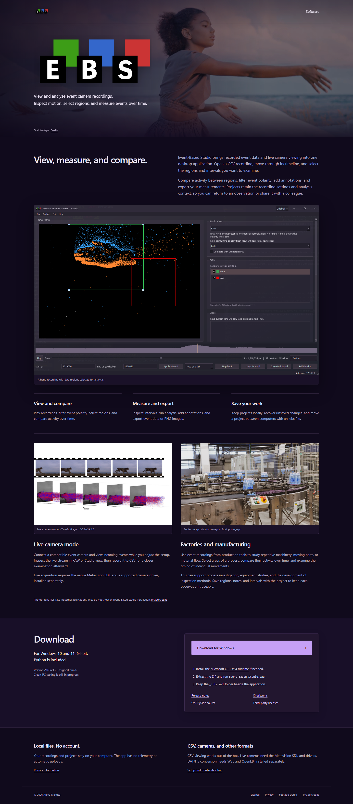
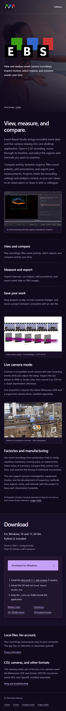

# Event-Based Studio

**[Download here](https://website.ebstudio.workers.dev/)**
**[Youtube Demo](https://www.youtube.com/watch?v=x0xSUJoST-o)**

View and analyse event-camera recordings. Inspect motion, compare regions,
and export measurements.

Mobile website snapshot

Website snapshots captured November 10, 2026.
[Image credits](docs/screenshots/PHOTO-CREDITS.txt) |
[Footage credits](docs/screenshots/FOOTAGE-CREDITS.txt).

[Setup and development](DEVELOPMENT.md) |
[Download guide](docs/DOWNLOAD.md) |
[Release notes](docs/RELEASE-NOTES.md)

Copyright (c) 2026 Alpha Makuza. Proprietary software; see [license](LICENSE.txt).
